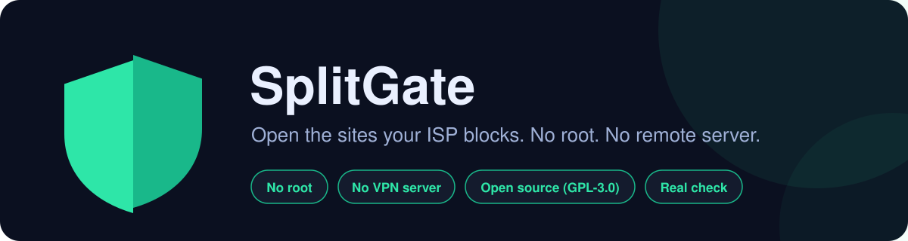
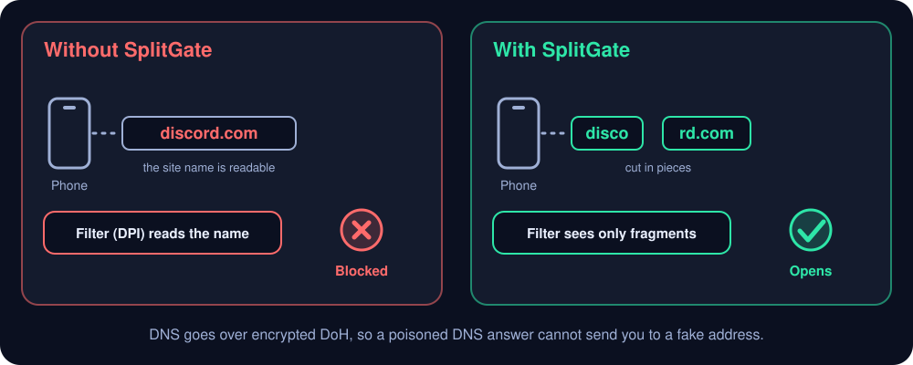
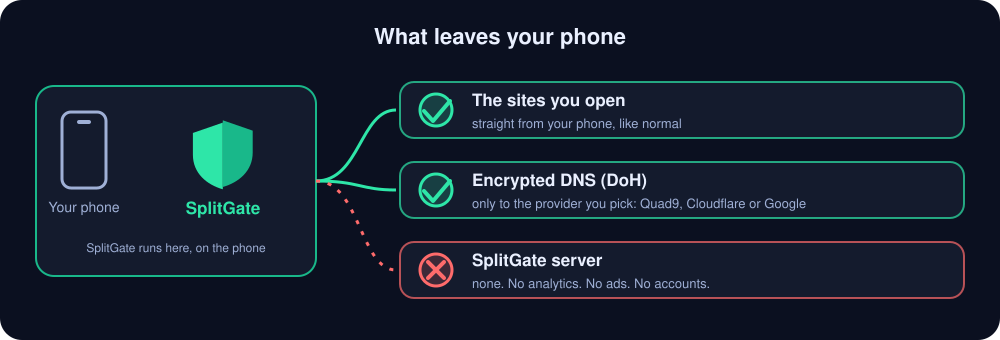

<p align="center"></p>

<p align="center">
  <a href="https://github.com/gmtr244/splitgate-android/releases/latest"></a>
</p>

<p align="center">
  <a href="https://github.com/gmtr244/splitgate-android/releases/latest"></a>
  <a href="https://github.com/gmtr244/splitgate-android/releases"></a>
  <a href="https://github.com/gmtr244/splitgate-android/stargazers"></a>
  <a href="LICENSE"></a>
  
</p>

**English** · [Türkçe](README.tr.md)

Some ISPs block sites such as Discord by reading the site name in the first packet of an HTTPS connection (DPI).
**SplitGate** gets around that **on your phone, without root and without any server**: it sets up a local
"fake VPN" with `VpnService`, cuts the connection's first packet into pieces so the filter cannot read the name, and
asks for DNS over encrypted DoH. Your traffic is not routed through any other server; it is processed on the phone and
goes out normally. Only the DNS lookups go to the DoH provider you pick.

## Get started in 3 steps

1. **Download** `SplitGate-<version>.apk` from [Releases](https://github.com/gmtr244/splitgate-android/releases/latest) and open it (allow installing from
   unknown sources when asked). Android 7.0 or newer.
2. Put the sites that are **blocked for you** in the *Test* section (the defaults are only examples), press the big power
   button and approve Android's VPN permission once.
3. Wait a few seconds for **Working**. If it says *Not working on this network*, it tells you why, and *Send report*
   lets you tell the developer.

## How it works

<p align="center"></p>

It works against filters that read the site name in a single packet. Where the block is something else (an IP block,
a connection that is intercepted, a filter that puts the pieces back together), the app checks, says so and tries the
other methods instead of pretending it works.

## Why you can trust it

<p align="center"></p>

Do not take our word for it; every line below can be checked.

| What we claim | How you can check it |
|---|---|
| **It asks for very little.** Internet, network state and notifications, plus Android's VPN permission. | `aapt2 dump permissions SplitGate-<version>.apk`, or Android Settings → Apps → SplitGate → Permissions. |
| **No tracking, no ads, no accounts, no libraries from anyone else.** | `dependencies { }` in `app/build.gradle` is empty; there is no analytics or crash-report code in the source. |
| **No SplitGate server.** The app only connects to the sites you open and, for DNS, to the DoH provider you chose. | The only built-in hosts are Quad9, Cloudflare and Google DNS (`engine/DohResolver.java`). Any firewall app will show the same. |
| **Nothing is written to disk but your settings.** The log lives in memory and disappears when the app closes; Android backups are off. | `LogBuffer.java`, and `allowBackup="false"` in `AndroidManifest.xml`. |
| **Reports are your choice.** Nothing is sent unless you press *Send report* and then send the e-mail yourself. A report never contains the sites you visit. | `Report.java`. It does contain the sites in the Test box and their results, so do not put private sites there. |
| **The APK is the maintainer's.** Signed with the release key, and every release has `SHA256SUMS.txt`. | `apksigner verify --print-certs SplitGate-<version>.apk` → SHA-256 `86:B1:BB:C7:D6:21:67:55:59:09:69:12:8A:C6:E9:75:E0:D5:DA:50:F9:2C:0C:EC:0B:09:80:28:58:40:6C:7C`. |
| **You can read and build all of it.** GPL-3.0-or-later; the engine's tests run on a PC without a phone. | `./tools/run-selftest.sh`, and [Building from source](#building-from-source). A build you make yourself has a different signature. |
| **Honest limits.** It cannot beat an IP block or a connection that is intercepted, and it says so when that is what it finds. | [Known limits](#known-limits). |

One more honest point: like every VPN-type app, SplitGate technically sees your phone's traffic while it runs, because
Android hands it to the app. It processes it on the phone and neither stores nor sends it. That is exactly why the
code is open: read it, or ask someone you trust to.

## Support the project

If SplitGate helped you, **please ⭐ star it on GitHub** (the button at the top right of this page). It costs nothing
and helps other people find it. Does it not work on your network? Use *Send report* in the app, or
[open an issue](https://github.com/gmtr244/splitgate-android/issues).

## Quick Settings tile

Swipe down the notification shade → pencil/edit icon → drag the **SplitGate** tile into the panel. Tap it to connect
or disconnect without opening the app. If the VPN permission was never granted, the first tap opens the app so you
can approve it once; after that the tile works on its own.

## Banking and government apps

Banking and government apps (and sites such as e-Devlet) often refuse to work while a bypass is on, either because they
detect a VPN or because their strict firewalls dislike a split connection. SplitGate lets you keep them out:

* **Apps → *Apps & sites* section.** Choose *All apps, except the ones I pick* and tick your bank and government apps
  (a button ticks the ones that look like bank / government apps for you to confirm; nothing is left out on its own).
  An app that is left out goes straight to the internet, behaves exactly as if SplitGate were off (plain DNS and IPv6 included), and Android's network checks no longer show it a VPN. An app that inspects network interface names can still notice one, so this cannot be guaranteed for every app. You can also choose
  *Only the apps I pick*: then only those apps use SplitGate and everything else is untouched. App changes apply the next
  time you connect; site changes apply at once.
* **Sites → same section.** For websites in the browser (you cannot leave the browser out, you need it for Discord) list
  your bank's and e-Devlet's sites under *All sites except the ones I list*, or choose *Only the sites I list*. This only
  decides which sites the connection is split for; the traffic still goes through SplitGate, so it does not hide the VPN.
* **Battery:** with *Only the apps I pick*, other apps do not touch SplitGate at all. When nothing is using it, SplitGate
  wakes up only when a packet arrives or every few seconds for housekeeping, and it updates its notification only while the
  screen is on. (Measured on one real phone with normal background traffic: the engine's retransmission timer slowed from about 4
  to about 1 wakeup per second. Other wake-ups remain, for example the notification while the screen is on.) The section also
  has a shortcut to Android's battery settings, in case your phone stops the app in the background.

The app list is read locally with Android's package visibility (no extra permission), is stored only on your phone, and
is never written to the log. A report contains only how many apps were left out, not which ones.

## What does it do?

| Feature | Description |
|---|---|
| **SNI splitting** | Splits the TLS ClientHello into TCP pieces around the host name (`discord.com` → `disco` / `rd.com`). DPI cannot see the name in a single packet. |
| **TLS + TCP splitting** | Optional: cuts the ClientHello in the middle of the site name into two separate TLS records, sent as two TCP pieces. If the ClientHello is incomplete, it is still TCP-split at the same point. |
| **Disorder (no root)** | The first piece of the ClientHello is sent with TTL 1 (`setsockopt` on the app's own socket), so it dies at the first router before the DPI sees it; the kernel resends it and the server gets the pieces out of order. For DPI that puts the pieces back together. |
| **Method per network** | Wi-Fi and each mobile operator get their own method. When you switch networks, open connections are reset so apps reconnect at once over the new network, and the saved method is used. |
| **Real check** | Every time you connect or switch networks, the chosen method is really tried on the test sites. The app says *Working* only if that succeeds; otherwise it tries the other methods, and if none works it says *Not working on this network* with the likely reason (DNS, IP block, interception, DPI). |
| **HTTP Host splitting** | Splits the Host value in port 80 requests. |
| **DNS-over-HTTPS** | All DNS queries sent over UDP (including hardcoded 8.8.8.8) are resolved over DoH through Quad9 (default), Cloudflare or Google. Gets around DNS poisoning. AAAA queries return empty (forces IPv4). |
| **QUIC block** | UDP 443 is dropped; Chrome/Discord fall back to TCP+TLS, where splitting can be applied. |
| **Other UDP** | (e.g. Discord voice) is forwarded as is. |

The app itself is excluded from the VPN (`addDisallowedApplication`), so there is no loop.

## Interface and notification

- **Tidy by design:** the main screen only has the power button, the status and the counters. Everything else is in
  sections that open when you tap their title (*Method & settings*, *Test*, *Privacy*, *Log*, *About*); the method
  and network that are in use are shown under the title of *Method & settings*.
- Dark theme, a big power button, live **downloaded / uploaded** amounts (B, KB, MB, GB) and current
  speed, counters for active connections / split / DNS, connection time.
- **Presets** (same position tokens as the Linux version, splitgate-linux): DNS only · Light (`midsld`) ·
  SNI start (`1`, `sni`, default) · Aggressive · **OOB byte** (1 urgent byte after the first piece) · TLS + TCP split ·
  **Disorder** (`1`) · **Disorder (site name)** (`midsld`) · **TLS + disorder**.
  A QUIC switch. Changing the method or the QUIC switch applies at once, no restart needed.
- **Switch to a working method by itself** (on by default): the method you choose, or the one the test recommends,
  is saved for the current network (Wi-Fi, or mobile per operator). If the check finds that the method does not open
  the test sites, the other methods are tried and the one that works is used and saved. A method you picked by hand
  is never changed. The Method card lists which method is saved for which network; *Forget saved networks* clears
  them.
- **Report:** *Send report* opens your e-mail app with a report addressed to the maintainer (*Share* sends it with any
  other app). It contains the app and Android version, the phone model, the network and operator, the settings, the
  last test results and the app's own status lines. It does **not** contain the sites you visit: connection and DNS
  lines are left out. Nothing is sent until you press send in your e-mail app.
- **DNS provider:** Quad9 / Cloudflare / Google; the selected one becomes primary, the others are fallbacks.
- **Test:** *Try methods* tries every preset on this network with a real TLS handshake, verifies the
  certificate, recommends the best one and selects it with *Apply recommended*. The sites it tries are in a box
  above the button; change them to sites that are blocked for you (up to 8, e.g. `example.org, news.example.net`).
  The defaults (discord.com, roblox.com, x.com, wattpad.com) are only examples.
- A collapsible **Log** section (closed by default): "Copy" and "Clear".
- **Notification:** On first start (Android 13+) the notification permission is requested. While connected
  a quiet, persistent notification shows: time, total ↓/↑ and speed, and a "Stop" button. While
  disconnected there is **no notification at all**. If the permission is not granted the VPN still works,
  only the notification is not shown.
- App icon: a shield split in the middle (adaptive icon).
- **Language:** English by default. The app asks for your language on first launch; the **🌐** button at the
  top right switches between English and Turkish at any time. Engine and service logs are always in
  English.

## Privacy / encryption

- This app does **not encrypt traffic itself**; it does not tunnel to a VPN server.
- DNS queries **are encrypted** (DoH). HTTPS sites already use their own TLS encryption.
- Plain HTTP (port 80) is unencrypted; your carrier can still see which IP addresses you connect to.
- The log is kept in memory only, never written to disk; it is erased when the app closes.

## Installing

Download the latest **`SplitGate-<version>.apk`** from the repository's **Releases** page and open it on your
phone ("allow installing from unknown sources" when asked). Android 7.0 (API 24) or newer is required. At most 700 TCP connections are processed at the same time (each one uses two worker threads); new ones beyond that are refused so the app cannot exhaust the phone's threads.
The app is not on the Play Store, so Android or Play Protect may ask you to confirm the install; that is normal.

To check that the file was not tampered with, compare its signing certificate with the fingerprint published in
the release notes:

```bash
apksigner verify --print-certs SplitGate-<version>.apk
```

## Building from source

You do not need this to use the app: just download the APK from Releases (see above). This section is for
developers who want to build their own copy.

Needs JDK 17 or newer (CI uses JDK 25) and the Android SDK (platform 36, build-tools 36). The build uses Gradle 9.8.1 and Android Gradle Plugin 9.4.1; the wrapper downloads Gradle by itself.

```bash
./gradlew assembleDebug      # app/build/outputs/apk/debug/app-debug.apk (debug key, for development)
./gradlew assembleRelease    # app/build/outputs/apk/release/ (R8-shrunk; signed only if keystore.properties exists)
```

`assembleRelease` makes an unsigned, R8-shrunk APK, and Android will not install an unsigned APK. You can sign it
with your own key, but that is not the maintainer's key: your build has a different signature, so it cannot update
(or be updated by) the official releases. If a git-ignored `keystore.properties` file (`storeFile`,
`storePassword`, `keyAlias`, `keyPassword`) exists in the project root, Gradle signs the release build with it.
Never commit a keystore or that file. In Android Studio: open the project folder, let the Gradle sync finish, then
**Build → Build APK(s)** or press ▶ (Run) with the phone connected over USB.

The GitHub Actions workflow runs the engine self-test and builds both variants on every push; the debug APK is
attached to the run as the `SplitGate-debug-apk` artifact (for testing only - releases come from a locally signed build).

## Testing

1. Open the app → press the power button → approve the VPN permission.
2. In the **Test** card press *Try methods*; apply the recommended preset (or pick one by hand). Open
   Discord or a blocked site.
3. If it does not work, change the DNS provider and repeat the test, and try turning the QUIC block on/off.
4. The log at the bottom shows lines like these for every connection:
   - `DNS discord.com (A) ok 41ms`
   - `discord.com:443  TLS OOB split @1,158`
5. When you switch between Wi-Fi and mobile data, the log shows
   `Network changed (Wi-Fi -> Mobile (…)): reset … connections` and, if needed, the automatic test result.
6. If it still fails, use **Copy** to take the log and the Test result and attach them to a bug report.

## Testing the engine on a computer (no Android needed)

Needs JDK 17 or newer.

```bash
./tools/run-selftest.sh
```

A fake "phone" TCP/UDP client writes packets to the TUN; the engine goes out to real loopback sockets.
Verified: checksums, TCP handshake/FIN, retransmission on packet loss, ClientHello splitting, DNS, UDP
forwarding, QUIC dropping, the strategy probe against a real TLS server, and the DoH client (SNI, Host
header, keep-alive, chunked replies, fallback).

## Known limits

- **Hotspot / tethering:** devices connected to your phone's hotspot are **not** filtered. Android forwards tethered traffic in the kernel, outside the VPN interface, and this cannot be changed without root. Only the phone's own traffic goes through SplitGate. To filter the traffic of other devices, use the Linux edition (`splitgate-linux`) on a computer that shares its connection: its `gateway` mode processes forwarded traffic too.
- **Only IPv4** is tunneled. AAAA queries return empty, so apps fall back to IPv4.
- DNS over TCP (port 53, for example when a UDP answer was too big) is answered over DoH like UDP, so no plain-text DNS leaves the phone. DNS-over-TLS (port 853) is already encrypted and is not intercepted; it goes out directly (with *Private DNS* in strict mode the phone uses its own resolver).
- Without root, **fake packets** (a decoy ClientHello sent before the real one) are not possible. Out-of-order
  sending (*Disorder*) works without root. On networks where none of the methods is enough, the app says so instead
  of claiming to work.
- If the DPI does not only look at the SNI (IP blocking, ECH, etc.) this method does not help.
- Whether the pieces leave as separate packets depends on the operating system; a delay of 0-3 ms (depending on the
  preset) is placed between the pieces.
- If the *Private DNS* setting on the phone is set to a host name in strict mode, DNS queries may bypass this
  app; leave it "Off" or "Automatic".
- Android runs only one VPN at a time.

## Project structure

```
app/src/main/java/com/projectgamers/splitgate/
  MainActivity.java        UI (power button, stats, method, test, language, log)
  NetworkId.java           which network we are on; method saved per network
  AndroidTtl.java          TTL of our own socket (for Disorder)
  Report.java              problem report (e-mail / share)
  LocaleHelper.java        in-app language selection
  PowerButton.java         power button (custom drawing)
  VpnTile.java             Quick Settings tile (connect / disconnect)
  Fmt.java                 B/KB/MB/GB formatting
  BypassVpnService.java    VpnService + TUN I/O + status notification + network changes, auto test
  LogBuffer.java           on-screen log
  engine/                  pure Java engine (no Android dependency)
    TunEngine.java         packet routing, DNS, UDP
    TcpSession.java        TCP termination + real socket + ClientHello splitting
    Strategy.java          split plan (position tokens, OOB, disorder)
    Sender.java            sends the planned pieces (TTL for Disorder)
    Presets.java           ready-made settings
    Probe.java             strategy probe (real TLS handshake)
    TlsSni.java            SNI parser
    DohResolver.java       DNS-over-HTTPS
app/src/main/res/values*/  translations (strings.xml: English, values-tr: Turkish)
tools/selftest/            JVM test
```

## Adding a language

Create `app/src/main/res/values-<code>/strings.xml` with the same keys as `values/strings.xml`, and add the
language to the `CODES` and `NAMES` arrays in `LocaleHelper.java`.

## FAQ

**Is it a VPN?** It uses Android's VPN interface to see your phone's traffic locally, but there is no VPN server and it
does not hide your IP address. It is not a privacy VPN.

**Does it work on a hotspot / when I share my connection?** Not on the phone: devices connected to your hotspot are not
filtered (Android forwards that traffic outside the VPN). The Linux edition
([splitgate-linux](https://github.com/gmtr244/splitgate-linux)) has a `gateway` mode for that.

**Which operators does it work with?** It depends on how your operator blocks. It was tried on Turkcell mobile data and
Wi-Fi (Android 16). Others are untested by the developer; the app tells you whether it works on yours, and *Send report*
helps us fix the ones that do not.

**Why does it say "Not working on this network"?** Because the check really failed. The reason is shown: DNS (DoH) cannot
be reached, an IP block, a connection that is intercepted, or a filter that beats every method.

**Why is it not on Google Play?** It is distributed here, on GitHub Releases. To update, install the new APK over the old
one (same signature, your settings are kept).

**Banking or e-Devlet apps do not work while SplitGate is on. What do I do?** Leave them out: *Apps & sites* → *All apps,
except the ones I pick* → choose them. They then go straight to the internet and Android's network checks no longer show them a VPN. For their websites
in the browser, use the site list there.

**Is IPv6 supported?** No. Only IPv4 is processed by SplitGate; IPv6 traffic is not touched, and because AAAA lookups return empty, apps use IPv4 through it.

## Forks and community editions

Forks and community editions are welcome under the GPL: you may change, redistribute or sell them as long as you
share the source under the same license and keep the copyright notices. Please use a different name, your own
signing key and your own applicationId so users do not confuse them with the official releases.

## License

Copyright © 2026 Project Gamers. [GNU GPL v3 or later](LICENSE) (GPL-3.0-or-later). Anyone who modifies and distributes the program must also
share the modified source code under the same license.

---

<p align="center">If SplitGate helped you, please <a href="https://github.com/gmtr244/splitgate-android">⭐ star it on GitHub</a>. Thank you!</p>
