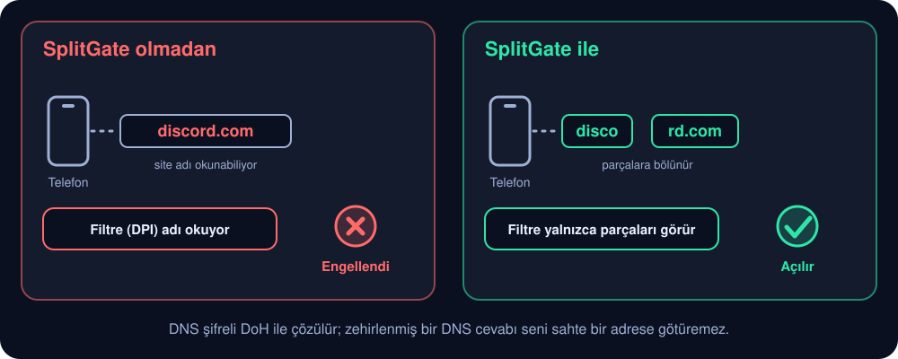
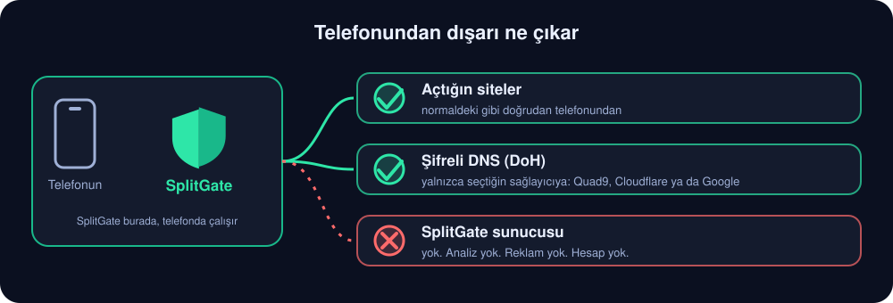

<p align="center"></p>

<p align="center">
  <a href="https://github.com/gmtr244/splitgate-android/releases/latest"></a>
</p>

<p align="center">
  <a href="https://github.com/gmtr244/splitgate-android/releases/latest"></a>
  <a href="https://github.com/gmtr244/splitgate-android/releases"></a>
  <a href="https://github.com/gmtr244/splitgate-android/stargazers"></a>
  <a href="LICENSE"></a>
  
</p>

[English](README.md) · **Türkçe**

Bazı operatörler, HTTPS bağlantısının ilk paketindeki site adını okuyarak (DPI) Discord gibi siteleri engeller.
**SplitGate** bunu **telefonunda, root olmadan ve hiçbir sunucu kullanmadan** aşar: `VpnService` ile yerel bir
"sahte VPN" kurar, bağlantının ilk paketini parçalara bölerek filtrenin adı okumasını engeller ve DNS'i şifreli DoH ile
çözer. Trafiğin başka bir sunucudan geçmez; telefonda işlenir ve normal şekilde çıkar. Yalnızca DNS sorguları seçtiğin
DoH sağlayıcısına gider.

## 3 adımda başla

1. [Sürümler](https://github.com/gmtr244/splitgate-android/releases/latest) sayfasından `SplitGate-<sürüm>.apk` dosyasını **indir** ve aç ("bilinmeyen
   kaynaklardan kuruluma izin ver" çıkarsa onayla). Android 7.0 veya üstü.
2. *Test* bölümüne **senin için engelli olan siteleri** yaz (varsayılanlar yalnızca örnektir), büyük güç düğmesine bas
   ve Android'in VPN iznini bir kez onayla.
3. Birkaç saniye içinde **Çalışıyor** yazmasını bekle. *Bu ağda çalışmıyor* derse nedenini söyler; *Rapor gönder*
   ile geliştiriciye de bildirebilirsin.

## Nasıl çalışır?

<p align="center"></p>

Site adını tek pakette okuyan filtrelere karşı çalışır. Engel başka bir şeyse (IP engeli, araya girilen bir bağlantı,
parçaları yeniden birleştiren bir filtre), uygulama bunu kontrol eder, söyler ve çalışıyormuş gibi yapmak yerine diğer
yöntemleri dener.

## Neden güvenebilirsin?

<p align="center"></p>

Lafımıza güvenme; aşağıdaki her satırı kendin kontrol edebilirsin.

| Ne iddia ediyoruz | Nasıl kontrol edersin |
|---|---|
| **Çok az şey ister.** İnternet, ağ durumu ve bildirim izni, bir de Android'in VPN izni. | `aapt2 dump permissions SplitGate-<sürüm>.apk` ya da Android Ayarlar → Uygulamalar → SplitGate → İzinler. |
| **İzleme yok, reklam yok, hesap yok, başkasının kütüphanesi yok.** | `app/build.gradle` içindeki `dependencies { }` boş; kaynakta analiz ya da çökme raporu kodu yok. |
| **SplitGate sunucusu yok.** Uygulama yalnızca açtığın sitelere, DNS için de seçtiğin DoH sağlayıcısına bağlanır. | Yerleşik adresler yalnızca Quad9, Cloudflare ve Google DNS (`engine/DohResolver.java`). Herhangi bir güvenlik duvarı uygulaması aynısını gösterir. |
| **Ayarların dışında diske hiçbir şey yazılmaz.** Günlük bellekte durur, uygulama kapanınca silinir; Android yedeği kapalı. | `LogBuffer.java` ve `AndroidManifest.xml` içinde `allowBackup="false"`. |
| **Raporu sen seçersin.** *Rapor gönder*'e basıp e-postayı kendin göndermedikçe hiçbir şey gitmez. Rapor gezdiğin siteleri içermez. | `Report.java`. Test kutusundaki siteler ve sonuçları rapora girer; o yüzden oraya özel siteler yazma. |
| **APK geliştiricinin kendisinden.** Yayın anahtarıyla imzalıdır, her sürümde `SHA256SUMS.txt` vardır. | `apksigner verify --print-certs SplitGate-<sürüm>.apk` → SHA-256 `86:B1:BB:C7:D6:21:67:55:59:09:69:12:8A:C6:E9:75:E0:D5:DA:50:F9:2C:0C:EC:0B:09:80:28:58:40:6C:7C`. |
| **Hepsini okuyabilir ve derleyebilirsin.** GPL-3.0-or-later; motorun testleri telefonsuz bilgisayarda çalışır. | `./tools/run-selftest.sh` ve [Kaynaktan derleme](#kaynaktan-derleme). Kendi derlediğin sürümün imzası farklı olur. |
| **Dürüst sınırlar.** IP engelini ya da araya girilen bağlantıyı aşamaz; bunu bulursa söyler. | [Bilinen sınırlar](#bilinen-sınırlar). |

Bir dürüst not daha: her VPN türü uygulama gibi SplitGate de çalışırken telefonunun trafiğini teknik olarak görür, çünkü
Android onu uygulamaya verir. Telefonda işler, saklamaz ve göndermez. Kodun açık olmasının sebebi tam olarak bu: oku ya
da güvendiğin birine okut.

## Projeyi destekle

SplitGate işine yaradıysa **lütfen GitHub'da ⭐ yıldızla** (bu sayfanın sağ üstündeki düğme). Hiçbir şeye mal olmaz ve
başkalarının da bulmasına yardım eder. Ağında çalışmıyor mu? Uygulamadaki *Rapor gönder*'i kullan ya da
[sorun aç](https://github.com/gmtr244/splitgate-android/issues).

## Hızlı Ayarlar kutucuğu

Bildirim panelini aşağı çek → kalem/düzenle simgesi → **SplitGate** kutucuğunu panele sürükle. Dokununca uygulamayı
açmadan bağlanır veya bağlantıyı keser. VPN izni hiç verilmediyse ilk dokunuş uygulamayı açar, izni bir kez onaylarsın;
sonrasında kutucuk kendi başına çalışır.

## Bankacılık ve devlet uygulamaları

Bankacılık ve devlet uygulamaları (ve e-Devlet gibi siteler), bir atlatma açıkken çoğu zaman çalışmaz: ya VPN'i fark
ederler ya da sıkı güvenlik duvarları bölünmüş bir bağlantıyı sevmez. SplitGate bunları dışarıda tutmanı sağlar:

* **Uygulamalar → *Uygulamalar ve siteler* bölümü.** *Hepsi, seçtiklerim hariç*'i seçip banka ve devlet uygulamalarını
  işaretle (bir düğme, banka/devlet gibi görünenleri senin onayın için işaretler; hiçbir şey kendiliğinden dışarıda
  kalmaz). Dışarıda bırakılan uygulama doğrudan internete çıkar, SplitGate kapalıymış gibi davranır (düz DNS ve IPv6 dahil) ve Android'in ağ kontrolleri ona artık VPN göstermez. Ağ arayüzü adlarına bakan bir uygulama yine de fark edebilir; bu yüzden her uygulama için garanti verilemez. *Yalnızca seçtiklerim*'i de
  seçebilirsin: o zaman yalnızca onlar SplitGate kullanır, geri kalan her şeye dokunulmaz. Uygulama değişiklikleri bir sonraki
  bağlanışta, site değişiklikleri hemen geçerli olur.
* **Siteler → aynı bölüm.** Tarayıcıdaki siteler için (tarayıcıyı dışarıda bırakamazsın, Discord için lazım) bankanın ve
  e-Devlet'in sitelerini *Yazdıklarım hariç tüm siteler*'in altına yaz ya da *Yalnızca yazdığım siteler*'i seç. Bu yalnızca
  bağlantının hangi siteler için bölüneceğini belirler; trafik yine SplitGate'ten geçer, yani VPN'i gizlemez.
* **Pil:** *Yalnızca seçtiklerim*'de diğer uygulamalar SplitGate'e hiç uğramaz. Hiçbir şey kullanmıyorken SplitGate yalnızca
  paket geldiğinde ya da birkaç saniyede bir bakım için uyanır ve bildirimini yalnızca ekran açıkken günceller. (Normal
  arka plan trafiği olan bir gerçek telefonda ölçüldü: motorun yeniden iletim zamanlayıcısı saniyede yaklaşık 4
  uyanmadan yaklaşık 1'e düştü. Başka uyanmalar sürer, örneğin ekran açıkken bildirim.) Bölümde ayrıca, telefon uygulamayı arka planda
  durduruyorsa, Android'in pil ayarlarına bir kısayol var.

Uygulama listesi Android'in paket görünürlüğüyle yerelde okunur (ek izin yok), yalnızca telefonunda saklanır ve günlüğe
hiç yazılmaz. Rapor yalnızca kaç uygulamanın dışarıda bırakıldığını içerir, hangilerini değil.

## Ne yapar?

| Özellik | Açıklama |
|---|---|
| **SNI bölme** | TLS ClientHello'yu host adının ortasından iki TCP parçasına böler (`discord.com` → `disco` / `rd.com`). DPI tek pakette adı göremez. |
| **TLS + TCP bölme** | İsteğe bağlı: ClientHello'yu site adının ortasından iki ayrı TLS kaydına böler, iki TCP parçası olarak yollar. ClientHello eksik gelirse yine aynı noktadan TCP bölmesi yapılır. |
| **Sıra bozma (root'suz)** | ClientHello'nun ilk parçası TTL 1 ile gönderilir (uygulamanın kendi soketinde `setsockopt`); DPI'a varmadan ilk router'da ölür, çekirdek onu yeniden gönderir ve sunucuya parçalar sırasız ulaşır. Parçaları birleştiren DPI'lar için. |
| **Ağa göre yöntem** | Wi-Fi ve her mobil operatör kendi yöntemini kullanır. Ağ değişince açık bağlantılar sıfırlanır, uygulamalar yeni ağdan hemen yeniden bağlanır ve o ağ için kayıtlı yöntem kullanılır. |
| **Gerçek kontrol** | Her bağlanışta ve ağ değişiminde seçili yöntem test sitelerinde gerçekten denenir. Uygulama ancak bu başarılıysa *Çalışıyor* der; değilse diğer yöntemleri dener, hiçbiri çalışmazsa olası nedeniyle (DNS, IP engeli, araya girme, DPI) *Bu ağda çalışmıyor* der. |
| **HTTP Host bölme** | Port 80 isteklerinde Host değerini böler. |
| **DNS-over-HTTPS** | UDP ile gönderilen tüm DNS sorguları (sabit yazılmış 8.8.8.8 dahil) DoH ile Quad9 (varsayılan), Cloudflare veya Google üzerinden çözülür. DNS zehirlemesini aşar. AAAA sorguları boş döner (IPv4'e zorlar). |
| **QUIC engeli** | UDP 443 düşürülür; Chrome/Discord TCP+TLS'e düşer ve orada bölebiliriz. |
| **Diğer UDP** | (ör. Discord ses) olduğu gibi iletilir. |

Uygulamanın kendisi VPN dışında tutulur (`addDisallowedApplication`), bu yüzden döngü olmaz.

## Arayüz ve bildirim

- **Derli toplu:** ana ekranda yalnızca güç düğmesi, durum ve sayaçlar var. Geri kalan her şey başlığına dokununca
  açılan bölümlerde (*Yöntem ve ayarlar*, *Test*, *Gizlilik*, *Günlük*, *Hakkında*); kullanılan yöntem ve ağ, *Yöntem ve
  ayarlar* başlığının altında görünür.
- Koyu tema, büyük güç düğmesi, canlı **indirilen / gönderilen** miktarı (B, KB, MB, GB) ve anlık hız,
  aktif bağlantı / bölünen / DNS sayaçları, bağlantı süresi.
- **Ön ayarlar** (Linux sürümü splitgate-linux ile aynı konum belirteçleri): Sadece DNS · Hafif (`midsld`) ·
  SNI başı (`1`, `sni`, varsayılan) · Agresif · **OOB baytlı** (ilk parçadan sonra 1 bayt urgent) · TLS + TCP böl ·
  **Sıra bozma** (`1`) · **Sıra bozma (site adı)** (`midsld`) · **TLS + sıra bozma**. QUIC anahtarı.
  Yöntem ya da QUIC anahtarı değişince hemen uygulanır, yeniden başlatmak gerekmez.
- **Çalışan yönteme kendisi geçsin** (varsayılan açık): seçtiğin ya da testin önerdiği yöntem o ağ için kaydedilir
  (Wi-Fi ya da operatöre göre mobil). Kontrol, yöntemin test sitelerini açmadığını görürse diğer yöntemler denenir;
  çalışan kullanılır ve kaydedilir. Elle seçtiğin yöntem değiştirilmez. Yöntem kartında hangi ağda hangi yöntemin
  kayıtlı olduğu görünür; *Kayıtlı ağları unut* hepsini siler.
- **Rapor:** *Rapor gönder* e-posta uygulamanı geliştiriciye yazılmış bir raporla açar (*Paylaş* başka bir uygulamayla
  gönderir). Raporda uygulama ve Android sürümü, telefon modeli, ağ ve operatör, ayarlar, son test sonuçları ve
  uygulamanın kendi durum satırları bulunur. Girdiğin siteler **bulunmaz**: bağlantı ve DNS satırları çıkarılır.
  E-posta uygulamasında gönder'e basmadan hiçbir şey gönderilmez.
- **DNS sağlayıcısı:** Quad9 / Cloudflare / Google; seçilen birincil olur, diğerleri yedek.
- **Test:** *Yöntemleri dene* her ön ayarı bu ağda gerçek TLS el sıkışmasıyla dener, sertifikayı doğrular,
  en iyisini önerir ve *Önerileni uygula* ile seçer. Denenen siteler butonun üstündeki kutuda; bunları senin için
  engelli olan sitelerle değiştir (en çok 8, örn. `ornek.org, haber.ornek.net`). Varsayılanlar (discord.com,
  roblox.com, x.com, wattpad.com) yalnızca örnektir.
- Katlanır **Günlük** bölümü (varsayılan kapalı): "Kopyala" ve "Temizle".
- **Bildirim:** İlk başlatmada (Android 13+) bildirim izni istenir. Bağlıyken sessiz, kalıcı bir bildirim
  görünür: süre, ↓/↑ toplam ve hız, "Durdur" düğmesi. Bağlantı kapalıyken **hiçbir bildirim yoktur**.
  İzin verilmezse VPN yine çalışır, sadece bildirim görünmez.
- Uygulama ikonu: ortadan bölünmüş kalkan (adaptive ikon).
- **Dil:** varsayılan İngilizce. İlk açılışta dil sorulur; sağ üstteki **🌐** düğmesiyle istediğin zaman Türkçe/İngilizce arasında geçebilirsin. Motor ve servis günlükleri dilden bağımsız İngilizcedir.

## Gizlilik / şifreleme

- Bu uygulama trafiği **kendisi şifrelemez**; bir VPN sunucusuna tünel kurmaz.
- DNS sorguları **şifrelenir** (DoH). HTTPS siteler zaten kendi TLS şifrelemesini kullanır.
- Düz HTTP (port 80) şifresizdir; operatör bağlandığın IP adreslerini görmeye devam eder.
- Günlük yalnızca bellekte tutulur, diske yazılmaz; uygulama kapanınca silinir.

## Kurulum

Deponun **Releases** sayfasından en son **`SplitGate-<sürüm>.apk`** dosyasını indirip telefonunda aç
("bilinmeyen kaynaklardan kuruluma izin ver" çıkarsa onayla). Android 7.0 (API 24) veya üstü gerekir. Aynı anda en çok 700 TCP bağlantısı işlenir (her biri iki iş parçacığı kullanır); fazlası reddedilir, böylece uygulama telefonun iş parçacıklarını tüketemez.
Uygulama Play Store'da olmadığı için Android veya Play Protect kurulumu onaylamanı isteyebilir; bu normaldir.

Dosyanın değiştirilmediğini görmek için imza sertifikasını sürüm notlarındaki parmak iziyle karşılaştır:

```bash
apksigner verify --print-certs SplitGate-<sürüm>.apk
```

## Kaynaktan derleme

Uygulamayı kullanmak için buna gerek yok: APK'yı Releases'tan indirmen yeter (yukarıya bak). Bu bölüm kendi kopyasını
derlemek isteyen geliştiriciler için.

JDK 17 veya daha yenisi (CI'da JDK 25) ve Android SDK (platform 36, build-tools 36) gerekir. Derleme Gradle 9.8.1 ve Android Gradle Plugin 9.4.1 kullanır; wrapper Gradle'ı kendisi indirir.

```bash
./gradlew assembleDebug      # app/build/outputs/apk/debug/app-debug.apk (debug anahtarı, geliştirme için)
./gradlew assembleRelease    # app/build/outputs/apk/release/ (R8 ile küçültülür; keystore.properties varsa imzalanır)
```

`assembleRelease` imzasız, R8 ile küçültülmüş bir APK üretir ve Android imzasız APK'yı kurmaz. Kendi anahtarınla
imzalayabilirsin, ama bu geliştiricinin anahtarı değildir: derlemen farklı bir imza taşır, bu yüzden resmî
sürümleri güncelleyemez (resmî sürümler de seninkini güncelleyemez). Proje kökünde, git tarafından yok sayılan bir
`keystore.properties` dosyası (`storeFile`, `storePassword`, `keyAlias`, `keyPassword`) varsa Gradle release
derlemesini onunla imzalar. Anahtarı ve bu dosyayı asla commit'leme. Android Studio'da: proje klasörünü aç, Gradle
sync bitsin, **Build → Build APK(s)** ya da telefon USB ile bağlıyken ▶ (Run).

GitHub Actions iş akışı her push'ta motor testini çalıştırır ve iki sürümü de derler; debug APK, yalnızca test için,
çalıştırmaya `SplitGate-debug-apk` adıyla eklenir (yayın sürümleri yerelde imzalanan derlemeden gelir).

## Test etme

1. Uygulamayı aç → güç düğmesine bas → VPN iznini onayla.
2. **Test** kartında *Yöntemleri dene*'ye bas; önerilen ön ayarı uygula (ya da elle seç). Discord/engelli siteyi aç.
3. Olmazsa DNS sağlayıcısını değiştirip testi tekrarla, QUIC engelini aç/kapat dene.
4. Alt kısımdaki log'da (her dilde İngilizce) her bağlantı için şu tür satırlar görünür:
   - `DNS discord.com (A) ok 41ms`
   - `discord.com:443  TLS OOB split @1,158`
5. Wi-Fi ile mobil veri arasında geçince logda `Network changed (Wi-Fi -> Mobil (…)): reset … connections` ve
   gerekirse otomatik test sonucu görünür.
6. Çalışmazsa **"Kopyala"** ile logu ve Test sonucunu alıp bir hata kaydına ekle.

## Motoru bilgisayarda test etme (Android gerekmez)

JDK 17 veya daha yenisi gerekir.

```bash
./tools/run-selftest.sh
```

Sahte bir "telefon" TCP/UDP istemcisi TUN'a paket yazar; motor gerçek loopback soketlerine çıkar.
Doğrulananlar: checksum'lar, TCP el sıkışma/FIN, paket kaybında yeniden iletim, ClientHello bölme,
DNS, UDP iletimi, QUIC düşürme, gerçek bir TLS sunucusuna karşı strateji sınaması ve DoH istemcisi (SNI, Host
başlığı, bağlantı yeniden kullanımı, chunked cevaplar, yedeğe geçiş).

## Bilinen sınırlar

- **Hotspot / bağlantı paylaşımı:** telefonunun hotspot'una bağlanan cihazlar **filtrelenmez**. Android paylaşılan trafiği çekirdekte, VPN arayüzünün dışında yönlendirir; root olmadan değiştirilemez. SplitGate'ten yalnızca telefonun kendi trafiği geçer. Diğer cihazların trafiğini filtrelemek için bağlantısını paylaşan bir bilgisayarda Linux sürümünü (`splitgate-linux`) kullan: `gateway` modu yönlendirilen trafiği de işler.
- **Sadece IPv4** tünellenir. AAAA sorguları boş döndüğü için uygulamalar IPv4'e düşer.
- TCP üzerinden DNS (port 53; örneğin UDP cevabı sığmayınca) UDP gibi DoH ile cevaplanır, yani telefondan düz metin DNS çıkmaz. DNS-over-TLS (port 853) zaten şifreli olduğu için yakalanmaz; doğrudan çıkar (*Özel DNS* katı modundaysa telefon kendi çözücüsünü kullanır).
- Root olmadan **sahte paket** (gerçeğinden önce sahte bir ClientHello) gönderilemez. Sıra bozma (*Sıra bozma*) root'suz çalışır.
  Hiçbir yöntemin yetmediği ağlarda uygulama çalışıyormuş gibi yapmaz, bunu söyler.
- DPI yalnızca SNI'ya bakmıyorsa (IP engeli, ECH vb.) bu yöntem işe yaramaz.
- Parçaların ayrı paket olarak çıkması işletim sistemine bağlıdır; paketler arasına ön ayara göre 0-3 ms bekleme konur.
- Telefonda *Özel DNS (Private DNS)* ayarı sıkı modda bir ana makine adına ayarlıysa DNS sorguları bu uygulamayı atlayabilir; "Kapalı" veya "Otomatik" bırak.
- Android'de aynı anda yalnızca bir VPN çalışır.

## Proje yapısı

```
app/src/main/java/com/projectgamers/splitgate/
  MainActivity.java        arayüz (güç düğmesi, istatistik, yöntem, test, dil, günlük)
  NetworkId.java           hangi ağdayız; ağa göre kayıtlı yöntem
  AndroidTtl.java          kendi soketimizin TTL'i (Sıra bozma için)
  Report.java              sorun raporu (e-posta / paylaş)
  LocaleHelper.java        uygulama içi dil seçimi
  PowerButton.java         güç düğmesi (özel çizim)
  VpnTile.java             Hızlı Ayarlar kutucuğu (bağlan / kes)
  Fmt.java                 B/KB/MB/GB biçimlendirme
  BypassVpnService.java    VpnService + TUN G/Ç + durum bildirimi + ağ değişimi, otomatik test
  LogBuffer.java           ekrandaki log
  engine/                  saf Java motor (Android'e bağımlı değil)
    TunEngine.java         paket yönlendirme, DNS, UDP
    TcpSession.java        TCP sonlandırma + gerçek soket + ClientHello bölme
    Strategy.java          bölme planı (konum belirteçleri, OOB, sıra bozma)
    Sender.java            planlanan parçaları gönderir (Sıra bozma için TTL)
    Presets.java           hazır ayarlar
    Probe.java             strateji sınaması (gerçek TLS el sıkışması)
    TlsSni.java            SNI ayrıştırıcı
    DohResolver.java       DNS-over-HTTPS
tools/selftest/            JVM testi
app/src/main/res/values*/  çeviriler (strings.xml: İngilizce, values-tr: Türkçe)
```

## Sık sorulanlar

**VPN mi bu?** Telefonunun trafiğini yerelde görmek için Android'in VPN arayüzünü kullanır, ama VPN sunucusu yoktur ve IP
adresini gizlemez. Bir gizlilik VPN'i değildir.

**Hotspot'ta / bağlantı paylaşırken çalışır mı?** Telefonda değil: hotspot'una bağlanan cihazlar filtrelenmez (Android o
trafiği VPN'in dışında yönlendirir). Bunun için Linux sürümünün
([splitgate-linux](https://github.com/gmtr244/splitgate-linux)) `gateway` modu var.

**Hangi operatörlerde çalışır?** Operatörünün nasıl engellediğine bağlıdır. Turkcell mobil veri ve Wi-Fi'da (Android 16)
denendi. Diğerlerini geliştirici denemedi; uygulama seninkinde çalışıp çalışmadığını söyler, çalışmayanları düzeltmemiz
için *Rapor gönder* yardım eder.

**Neden "Bu ağda çalışmıyor" diyor?** Çünkü kontrol gerçekten başarısız oldu. Nedeni de yazar: DNS'e (DoH) ulaşılamıyor,
IP engeli, araya girilen bir bağlantı ya da her yöntemi yakalayan bir filtre.

**Neden Google Play'de yok?** Burada, GitHub Sürümleri'nden dağıtılır. Güncellemek için yeni APK'yi eskisinin üstüne kur
(imza aynı, ayarların korunur).

**Banka ya da e-Devlet uygulamaları SplitGate açıkken çalışmıyor, ne yapmalıyım?** Onları dışarıda bırak: *Uygulamalar ve
siteler* → *Hepsi, seçtiklerim hariç* → onları seç. Böylece doğrudan internete çıkarlar ve Android'in ağ kontrolleri onlara artık VPN göstermez. Tarayıcıdaki
siteleri için oradaki site listesini kullan.

**IPv6 destekleniyor mu?** Hayır. SplitGate yalnızca IPv4'ü işler; IPv6 trafiğine dokunmaz ve AAAA sorguları boş döndüğü için uygulamalar IPv4'ü kullanır.

## Çatallar ve topluluk sürümleri

Çatallar ve topluluk sürümleri GPL kapsamında serbesttir: kaynağı aynı lisansla paylaşıp telif bildirimlerini
korudukları sürece değiştirebilir, dağıtabilir ve satabilirler. Kullanıcılar resmî sürümlerle karıştırmasın diye
lütfen farklı bir ad, kendi imza anahtarınızı ve kendi applicationId'nizi kullanın.

## Lisans

Telif hakkı © 2026 Project Gamers. [GNU GPL v3 veya üstü](LICENSE) (GPL-3.0-or-later). Programı değiştirip dağıtan herkes, değişen kaynak kodunu da aynı lisansla paylaşmak zorundadır.

## Yeni dil eklemek

`app/src/main/res/values-<kod>/strings.xml` dosyasını `values/strings.xml` ile aynı anahtarlarla oluştur, `LocaleHelper.java` içindeki `CODES` ve `NAMES` dizilerine dili ekle.

---

<p align="center">SplitGate işine yaradıysa lütfen <a href="https://github.com/gmtr244/splitgate-android">GitHub'da ⭐ yıldızla</a>. Teşekkürler!</p>
